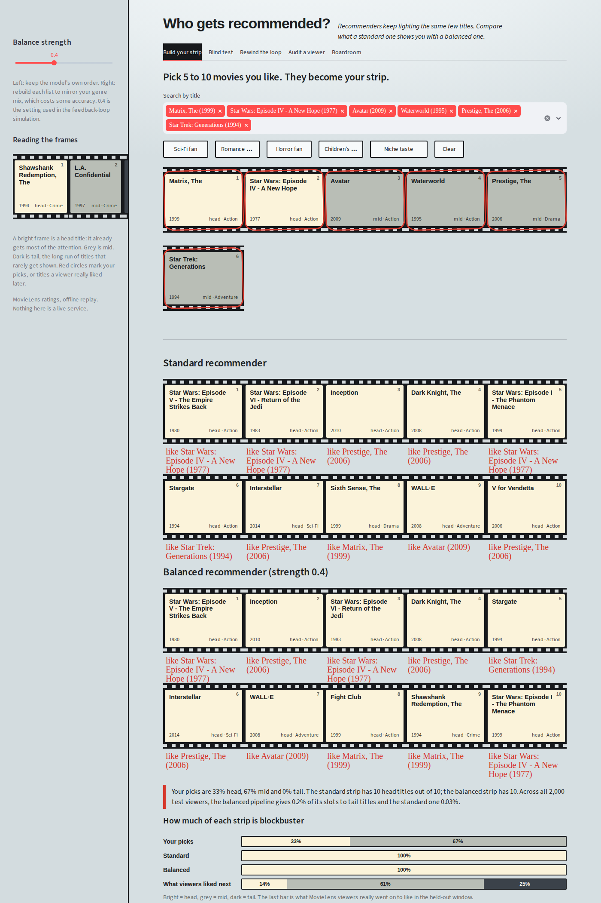

# Who gets recommended?

A popularity-bias audit of movie recommenders on **MovieLens 32M**, plus an interactive Streamlit app that lets you see the problem, the fix, and what the fix costs.



Recommenders trained on clicks keep showing the titles that are already popular, those titles collect more clicks, and the next model shows them even more. This project measures how bad that is, tests ways to reduce it, and checks whether a fix survives a feedback loop.

---

## Headline results

All numbers come from `artifacts/results.json`, produced by the notebook (20,000 evaluation users, 87,585 titles, per-user temporal split).

| | Standard ALS | Balanced (inverse-popularity ALS + calibrated re-rank) |
|---|---|---|
| Accuracy, NDCG@10 | 0.1249 | ≈ 99.95% of ALS (ΔNDCG −0.0001 ± 0.0012) |
| Recommendation slots on **tail** titles | 0.07% | 0.22% |
| Share of catalog ever recommended | 1.44% | 1.94% |
| Effective titles (exp. entropy of exposure) | 419 | 445 |
| Genre mismatch vs the user's own taste (TVD) | 0.292 | 0.251 |

- **The bias is large.** 48.4% of ALS slots go to head titles, but only 14.4% of what viewers actually liked later was head; tail titles hold 26.9% of real demand and get 0.07% of slots. A pure popularity ranker puts 99.9% of slots on the head.
- **Accuracy ranking of the models tried:** Hybrid (ALS + content) 0.1256 > ALS 0.1249 > PureSVD 0.1232 > Item-kNN 0.1182 > Popularity 0.0733 > Weighted-rating 0.0643 > Content-only 0.0032 > Random 0.0001. ALS was used as the baseline for the audit.
- **The fix is cheap but modest.** At a 5% accuracy budget (picked on validation data), the mitigation costs essentially no accuracy but moves tail exposure only from 0.07% to 0.22%. Be honest about this when presenting it: it is a small shift in absolute terms.
- **Feedback-loop simulation** (3,000 simulated users, 8,000 titles, 24 rounds, 3 seeds): titles ever shown rise from 10.8% to 16.1%, effective titles +15.6%, at a cost of −2.3% clicks (range −2.26% to −2.34% across seeds).
- **Business what-if** (illustrative, not a forecast): net annual value ≈ +$187K for a 1M-subscriber service under base assumptions, ranging from −$116K (pessimistic) to +$483K (optimistic). Most of the upside comes from the licence-utilisation assumption, which has the least evidence behind it.

---

## What's in the app

Run it and you get five tabs and a sidebar slider (**balance strength**, λ: 0 = the model's own order, 0.95 = rebuild the list to mirror the user's genre mix).

| Tab | What it does |
|---|---|
| **Build your strip** | Pick 5–10 movies; get a standard and a balanced list for a brand-new user (ALS fold-in), with "because you picked…" notes, exposure bars and a 2-D catalog map. |
| **Blind test** | A real MovieLens viewer and two unlabeled lists. Choose one, then see which was which and which titles the viewer really liked later. |
| **Rewind the loop** | Replays the feedback-loop simulation round by round: standard-learning, balanced-learning, and a frozen control. |
| **Audit a viewer** | Pick or randomise one of 2,000 test viewers; compare lists, hits, and population-wide trade-off curves at the chosen λ. |
| **Boardroom** | Sliders for subscribers, ARPU, margin, licence costs and churn assumptions, with Pessimistic / Base / Optimistic presets. |

Frames in the film strips are shaded by popularity tier: bright = head, grey = mid, dark = tail. Red circles mark your picks or titles a viewer liked later.

---

## Quick start

```bash
git clone https://github.com/PritheshBijlani/who-gets-recommended.git
cd who-gets-recommended
python -m venv .venv && source .venv/bin/activate     # Windows: .venv\Scripts\activate
pip install -r requirements.txt
streamlit run app/app.py
```

The curated `artifacts/` folder is included, so the app runs without downloading MovieLens or re-running the notebook.

Run the smoke tests:

```bash
pip install pytest
python -m pytest tests -q
```

They check that `λ=0` reproduces the model's order, lists never contain already-liked titles, group shares sum to 1, cold-start recommendations work, and the business calculation reproduces `results.json`.

---

## Repository layout

```
├── README.md
├── LICENSE                     # MIT
├── requirements.txt            # app dependencies
├── requirements-notebook.txt   # extra packages to re-run the notebook
├── app/
│   ├── app.py                  # Streamlit UI (5 tabs)
│   ├── core.py                 # pure NumPy/pandas logic: loading, re-ranking, fold-in, business case
│   └── style.py                # CSS and HTML helpers ("photographer's light table" theme)
├── artifacts/                  # precomputed outputs the app reads (see below)
├── docs/
│   └── screenshot.png
├── notebook/
│   └── popularity_bias_audit_ml32m.ipynb   # the full analysis and the export cells
└── tests/
    └── test_core.py
```

`app.py` looks for `artifacts/` inside `app/` first and then next to it, so the layout above works as is.

### Artifacts

| File | Contents |
|---|---|
| `items.csv` | The 15,000 most-rated titles shown in the app: title, genres, head/mid/tail group, training count, popularity percentile |
| `pools.npz` | For 2,000 test users: top-100 candidate pools and scores for both pipelines, genre matrix, user genre profiles |
| `history.npz`, `future.npz` | Each user's liked titles before the cut-off, and the titles they liked after it (the "hits") |
| `factors.npz` | Item factors for both ALS models plus `Q'Q` over the full catalog, used for the cold-start fold-in |
| `pop_metrics.csv` | Population metrics for the standard list and for each λ in the slider |
| `loop.csv` | Round-by-round results of the feedback-loop simulation |
| `business.json` | Simulation outputs and default business assumptions with low/high ranges |
| `meta.json` | Slider values, K, genre list, dataset info |
| `results.json` | Final summary numbers for the whole study |

---

## Method in brief

**Data and split.** MovieLens 32M (32,000,204 ratings, 200,948 users, 87,585 titles, 1995–2023). Each user's ratings are split in time order: first 70% train, next 10% validation (all tuning), last 20% test. A rating of 4 or more counts as "liked". Leakage checks run before any model is fitted.

**Popularity groups.** Titles are ranked by training ratings. *Head* = the top titles that together hold the first 20% of ratings, *tail* = the least-rated titles holding the last 20%, *mid* = the rest. Groups are computed from training data only.

**Models.** Random, popularity, weighted-rating popularity, item-kNN, PureSVD, implicit ALS (64 factors), content-based, and an ALS + content hybrid, tuned on validation.

**Audit metrics.** Head/tail share of slots, catalog coverage, Gini of exposure, effective titles (exp. of the entropy of exposure), intra-list diversity, genre mismatch (total variation distance between the user's genre profile and the list's), and NDCG@10, with 95% confidence intervals on paired differences.

**Mitigations compared.** (1) a popularity penalty on scores, (2) calibrated greedy re-ranking, which trades relevance against KL divergence between the user's genre mix and the list's, (3) inverse-popularity weighted ALS training (γ), and (4) the combination of (3) and (2): inverse-popularity training followed by calibrated re-ranking. Operating points were chosen on validation under 2%, 5% and 10% accuracy budgets. The app uses the **5% budget, combined method**: γ = 0.25, λ = 0.4.

**Feedback-loop simulation.** An explicit-rating "oracle" model is fitted on simulated users and titles. Each round, simulated viewers see recommendations with position bias, click according to the oracle, and the recommender retrains on the new clicks every 4 rounds. Three arms run: standard ALS, mitigated, and standard ALS that never retrains (a control that separates the loop's effect from simply running out of titles). A sensitivity sweep varies position bias, retraining frequency and catalog size.

**Business what-if.** Converts three simulation outputs (coverage, effective titles, clicks) into dollars using explicit assumptions about retention, margin and licence utilisation. See `core.business_case`.

---

## Reproducing the artifacts

1. Install the notebook extras: `pip install -r requirements-notebook.txt`.
2. Open `notebook/popularity_bias_audit_ml32m.ipynb` and run all cells. The first cell downloads MovieLens 32M (about 239 MB) from GroupLens into `notebook/data/`. Full-scale ALS training and the simulation are slow, and the notebook has `FAST` / `SIM_FAST` switches.
3. The export cells (29–31) write a fresh `artifacts/` next to the notebook. Copy its contents over the repo-root `artifacts/` folder.

---

## Caveats

- **App numbers differ slightly from the notebook's.** The app works on a 2,000-user, 15,000-title subset (`n_app_items` in `meta.json`) so it loads fast, while `results.json` uses the full catalog and 20,000 users. For example, the app's population table shows tail share 0.205% at λ = 0.4, versus 0.22% in the notebook.
- **Accuracy "kept" can exceed 100% in the app.** At low λ the inverse-popularity ALS pool scores slightly higher than the standard list on this subset (e.g. 103.5% at λ = 0), then falls as λ rises (73% at λ = 0.95). That is a property of the subset, not a claim that balancing improves accuracy.
- **The tail gain is small in absolute terms**, and tail exposure stays well below real tail demand.
- **Offline replay, not an A/B test.** "Hits" are titles a user liked later in the held-out window; real users never saw these lists. The simulation and the business case rest on stated assumptions and are illustrations, not forecasts.
- **Cold-start picks are a rough profile.** A handful of picks gives a rough taste vector. The notebook checks fold-in vectors against trained user vectors by cosine similarity.
- **Streamlit deprecation.** `app.py` uses `use_container_width`, which newer Streamlit versions flag as deprecated (in favour of `width="stretch"`). It works on the tested version, 1.66.1, but expect to update it eventually.

---

## Data and licence

MovieLens 32M is provided by [GroupLens](https://grouplens.org/datasets/movielens/32m/) for research use; check its terms before redistributing the raw data, and cite: F. Maxwell Harper and Joseph A. Konstan, *The MovieLens Datasets: History and Context*, ACM TiiS 5(4), 2015. The `artifacts/` folder contains derived data (title names, genres, aggregated counts, model factors), not the raw ratings. The code in this repository is released under the [MIT licence](LICENSE). The MovieLens data and the derived files in `artifacts/` stay subject to the GroupLens terms above.
